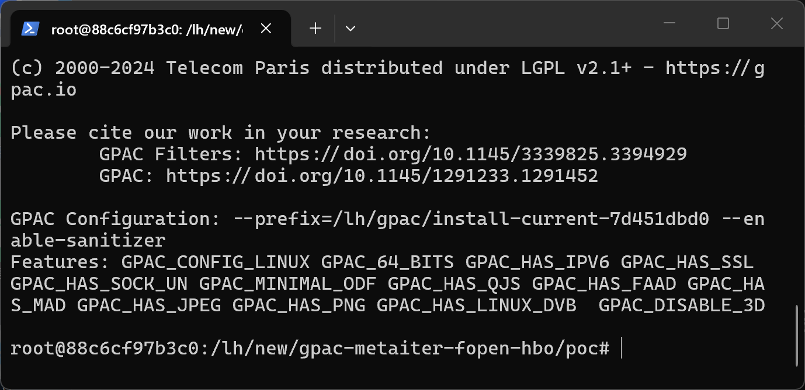
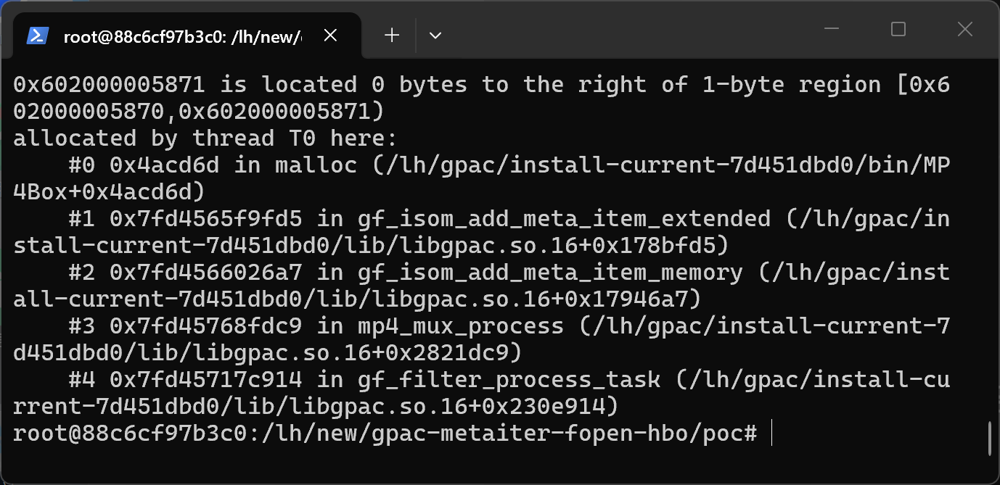
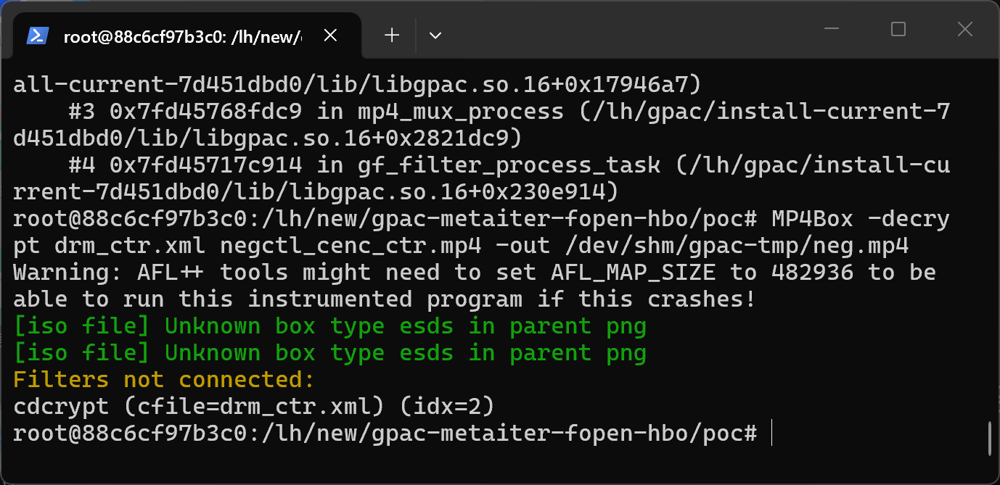

# GPAC 7d451dbd0 (master) — CWE-125 in DoWriteMeta

## Summary
GPAC (G Pac Media Framework) master commit 7d451dbd0 is affected by cwe-125 in DoWriteMeta. A crafted media file processed by MP4Box causes an out-of-bounds memory access with attacker-controlled content, leading to information disclosure and denial of service.

## Affected Product

| Field | Value |
|---|---|
| Vendor | GPAC |
| Product | GPAC / MP4Box |
| Affected versions | master commit 7d451dbd0 (libgpac ABI 16.27.0); earlier versions likely affected |
| Component | src/isomedia/meta.c:1772-1776 (gf_isom_add_meta_item_extended), consumed at src/isomedia/isom_store.c:900 (DoWriteMeta) |
| Platform | Linux x86_64 (Ubuntu 22.04), ASan build; architecture-independent source defect |
| Vulnerability type | CWE-125: Out-of-bounds Read (root cause CWE-170: Improper Null Termination) |

## Root Cause
**Location:** `src/isomedia/meta.c:1772-1776 (gf_isom_add_meta_item_extended), consumed at src/isomedia/isom_store.c:900 (DoWriteMeta)`

MP4Box -decrypt crashes with an AddressSanitizer heap-buffer-overflow READ when the output file is closed. The input sample is a crafted MP4 whose meta box items are re-added from memory when the file is re-written by the mp4 mux filter (src/filters/mux_isom.c:6068 calls gf_isom_add_meta_item_memory). In gf_isom_add_meta_item_extended, the branch that stores the item path for inline-data items allocates full_path with exactly data_len bytes and copies data_len bytes without appending a NUL terminator, so the stored path is not a valid C string. Later, when the rewritten file is closed, DoWriteMeta opens the path of every self-contained item with gf_fopen(iinf->full_path, "rb"), which reads the unterminated heap buffer past its end.

```c
infe->full_path = (char *)gf_malloc(sizeof(char) * data_len);
if (!infe->full_path) return GF_OUT_OF_MEM;

memcpy(infe->full_path, data, sizeof(char) * data_len);
/* no NUL terminator: full_path is later used as a C string by gf_fopen() */
```

## Proof of Concept

### Prerequisites
- MP4Box built from master (7d451dbd0); a plain release build exhibits the same memory error (verified under ASan).

### Steps to Reproduce
1. Extract the attached sample into a working directory.



2. Run the reproduction command:

```
MP4Box -decrypt drm_ctr.xml poc_meta_item_path.mp4 -out out.mp4
```

3. The process aborts with the sanitizer report below.



4. Negative control - the unmutated corpus file runs cleanly:

```
MP4Box -decrypt drm_ctr.xml negctl_cenc_ctr.mp4 -out negctl-out.mp4
```



### Expected vs Actual
- Expected: the parser rejects the malformed input with an error message.
- Actual: out-of-bounds memory access; under ASan the process aborts, in release builds the process crashes or silently reads adjacent heap memory.

### Sanitized PoC input
```text
poc_meta_item_path.mp4 (binary/xml sample attached, SHA256 in SHA256SUMS.txt)
```

## Impact
- Confidentiality: High (out-of-bounds read of adjacent heap memory; the unterminated path is further passed to string handling)
- Integrity: None
- Availability: High (process abort under ASan, segmentation fault likely in release builds)
- Scope: memory corruption limited to the MP4Box process.

## Remediation
Allocate data_len+1 bytes and NUL-terminate infe->full_path in the data branch of gf_isom_add_meta_item_extended (src/isomedia/meta.c:1772), or keep the length in infe->data_len and replace C-string consumers with bounded copies.

## References
- Source repository: https://github.com/gpac/gpac
- Upstream report: [pending publication]
- CWE: CWE-125
- Vendor advisory: [none]

