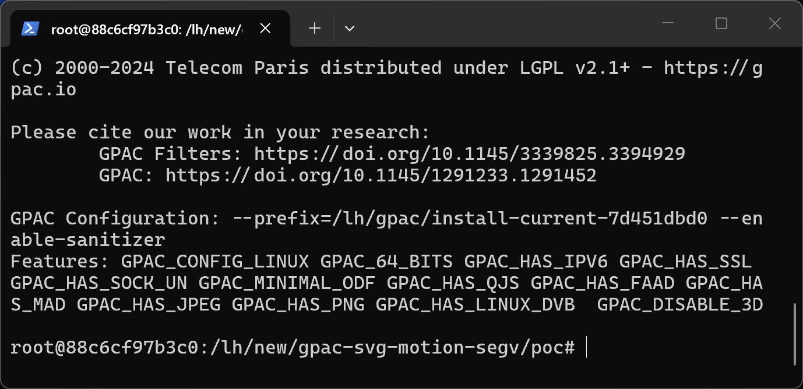
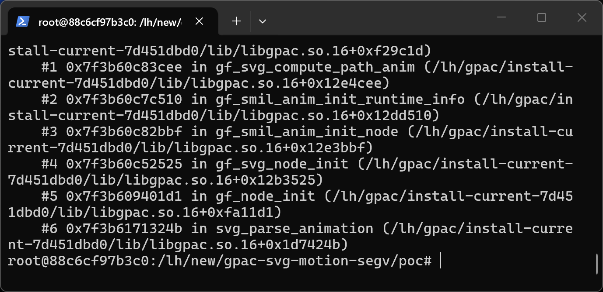
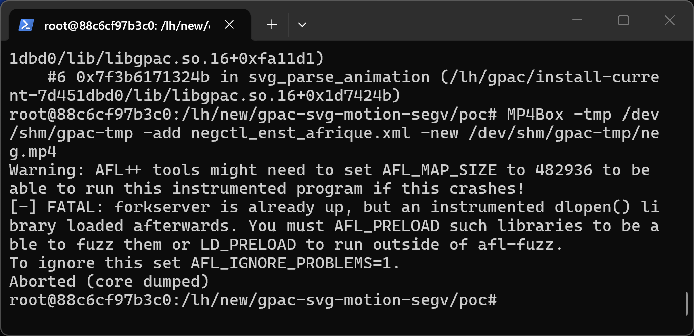

# GPAC 7d451dbd0 (master) — CWE-125 in gf_path_iterator_get_transform

## Summary
GPAC (G Pac Media Framework) master commit 7d451dbd0 is affected by cwe-125 in gf_path_iterator_get_transform. A crafted media file processed by MP4Box causes an out-of-bounds memory access with attacker-controlled content, leading to information disclosure and denial of service.

## Affected Product

| Field | Value |
|---|---|
| Vendor | GPAC |
| Product | GPAC / MP4Box |
| Affected versions | master commit 7d451dbd0 (libgpac ABI 16.27.0); earlier versions likely affected |
| Component | src/scenegraph/smil_anim.c:567-573 (gf_svg_compute_path_anim) and src/utils/path2d.c:1220 (gf_path_iterator_get_transform) |
| Platform | Linux x86_64 (Ubuntu 22.04), ASan build; architecture-independent source defect |
| Vulnerability type | CWE-125: Out-of-bounds Read |

## Root Cause
**Location:** `src/scenegraph/smil_anim.c:567-573 (gf_svg_compute_path_anim) and src/utils/path2d.c:1220 (gf_path_iterator_get_transform)`

MP4Box crashes with a segmentation fault (AddressSanitizer SEGV on a read access) while parsing a crafted SVG/LASeR file containing an animateMotion animation whose path data does not cover the animation length. gf_svg_compute_path_anim (src/scenegraph/smil_anim.c:567-573) computes offset = normalized_simple_time * rai->length and passes it unclamped to gf_path_iterator_get_transform (src/utils/path2d.c:1220), which walks the path segment list assuming offset lies within the path; with a degenerate or truncated path built from the animation values the iterator walks past the point array and reads unmapped memory.

```c
static void gf_svg_compute_path_anim(SMIL_Anim_RTI *rai, GF_Matrix2D *m, Fixed normalized_simple_time)
{
	Fixed offset;
	offset = gf_mulfix(normalized_simple_time, rai->length);
	gf_mx2d_init(*m);
	/* no validation that offset is within the parsed path length */
	gf_path_iterator_get_transform(rai->path_iterator, offset, 1, m, 1, 0);
```

## Proof of Concept

### Prerequisites
- MP4Box built from master (7d451dbd0); a plain release build exhibits the same memory error (verified under ASan).

### Steps to Reproduce
1. Extract the attached sample into a working directory.



2. Run the reproduction command:

```
MP4Box -tmp /tmp -add poc_anim_motion_segv.xml -new /tmp/out.mp4
```

3. The process aborts with the sanitizer report below.



4. Negative control - the unmutated corpus file runs cleanly:

```
MP4Box -tmp /tmp -add negctl_enst_afrique.xml -new /tmp/negctl-out.mp4
```



### Expected vs Actual
- Expected: the parser rejects the malformed input with an error message.
- Actual: out-of-bounds memory access; under ASan the process aborts, in release builds the process crashes or silently reads adjacent heap memory.

### Sanitized PoC input
```text
poc_anim_motion_segv.xml (binary/xml sample attached, SHA256 in SHA256SUMS.txt)
```

## Impact
- Confidentiality: Low (adjacent heap data may be read into the computed transform)
- Integrity: None
- Availability: High (process crash)
- Scope: memory corruption limited to the MP4Box process.

## Remediation
Clamp the iterator offset to the actual path length in gf_svg_compute_path_anim, and make gf_path_iterator_get_transform return early when the path has no usable segments or offset exceeds the total length.


## References
- Source repository: https://github.com/gpac/gpac
- Upstream report: [pending publication]
- CWE: CWE-125
- Vendor advisory: [none]

