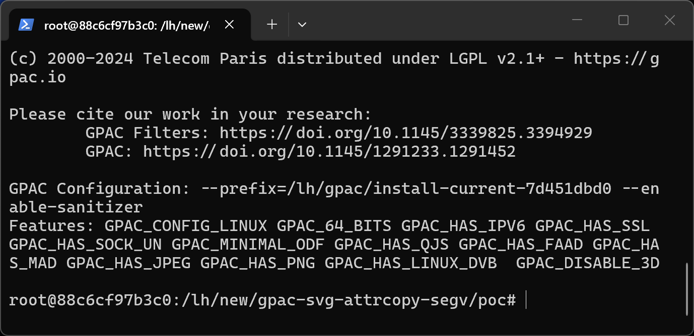
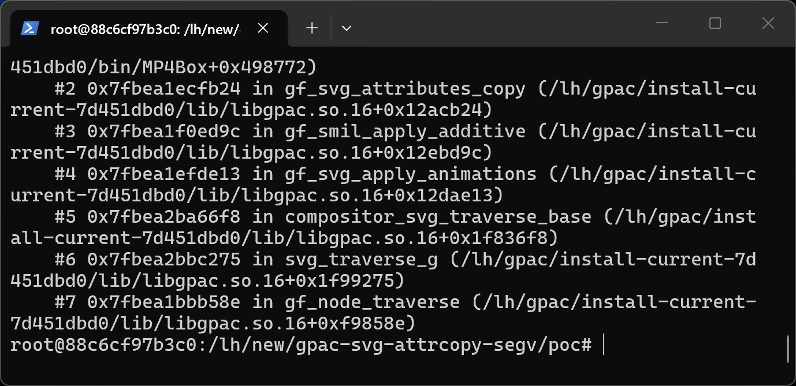
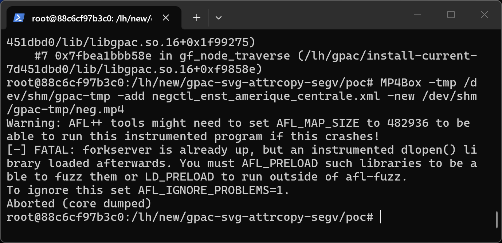

# GPAC 7d451dbd0 (master) — CWE-476 in gf_svg_attributes_copy, SVG_String branch

## Summary
GPAC (G Pac Media Framework) master commit 7d451dbd0 is affected by cwe-476 in gf_svg_attributes_copy, SVG_String branch. A crafted media file processed by MP4Box causes an out-of-bounds memory access with attacker-controlled content, leading to information disclosure and denial of service.

## Affected Product

| Field | Value |
|---|---|
| Vendor | GPAC |
| Product | GPAC / MP4Box |
| Affected versions | master commit 7d451dbd0 (libgpac ABI 16.27.0); earlier versions likely affected |
| Component | src/scenegraph/smil_anim.c (gf_smil_apply_additive) feeding src/scenegraph/svg_attributes.c:6346 (gf_svg_attributes_copy, SVG_String branch) |
| Platform | Linux x86_64 (Ubuntu 22.04), ASan build; architecture-independent source defect |
| Vulnerability type | CWE-476: NULL Pointer Dereference (wild pointer from uninitialized GF_FieldInfo) |

## Root Cause
**Location:** `src/scenegraph/smil_anim.c (gf_smil_apply_additive) feeding src/scenegraph/svg_attributes.c:6346 (gf_svg_attributes_copy, SVG_String branch)`

MP4Box crashes with a segmentation fault inside strlen()/strdup() when the compositor renders a crafted SVG/LASeR animation file. gf_smil_apply_additive (src/scenegraph/smil_anim.c) calls gf_svg_attributes_copy(&rai->owner->presentation_value, &rai->interpolated_value, 1); for an animation whose interpolated_value was never computed (string-typed attribute, values failed to initialize), the GF_FieldInfo far_ptr holds garbage, and the SVG_String branch of gf_svg_attributes_copy (src/scenegraph/svg_attributes.c:6346) calls gf_strdup() on that wild pointer, which faults inside strlen().

```c
/* smil_anim.c, non-additive branch */
gf_svg_attributes_copy(&rai->owner->presentation_value, &rai->interpolated_value, 1);
/* svg_attributes.c:6346, SVG_String_datatype branch */
* (SVG_String *)a->far_ptr = *(SVG_String *)b->far_ptr ? gf_strdup(*(SVG_String *)b->far_ptr) : NULL;
/* b->far_ptr points to garbage when interpolated_value was never initialized */
```

## Proof of Concept

### Prerequisites
- MP4Box built from master (7d451dbd0); a plain release build exhibits the same memory error (verified under ASan).

### Steps to Reproduce
1. Extract the attached sample into a working directory.



2. Run the reproduction command:

```
MP4Box -tmp /tmp -add poc_smil_attrcopy_segv.xml -new /tmp/out.mp4
```

3. The process aborts with the sanitizer report below.



4. Negative control - the unmutated corpus file runs cleanly:

```
MP4Box -tmp /tmp -add negctl_enst_amerique_centrale.xml -new /tmp/negctl-out.mp4
```



### Expected vs Actual
- Expected: the parser rejects the malformed input with an error message.
- Actual: out-of-bounds memory access; under ASan the process aborts, in release builds the process crashes or silently reads adjacent heap memory.

### Sanitized PoC input
```text
poc_smil_attrcopy_segv.xml (binary/xml sample attached, SHA256 in SHA256SUMS.txt)
```

## Impact
- Confidentiality: Low (wild pointer read)
- Integrity: None
- Availability: High (process crash)
- Scope: memory corruption limited to the MP4Box process.


## Remediation
Initialize rai->interpolated_value (fieldType and far_ptr) when the SMIL runtime info is created, and skip the copy in gf_smil_apply_additive when interpolated_value.far_ptr is NULL for the declared fieldType.


## References
- Source repository: https://github.com/gpac/gpac
- Upstream report: [pending publication]
- CWE: CWE-476
- Vendor advisory: [none]

