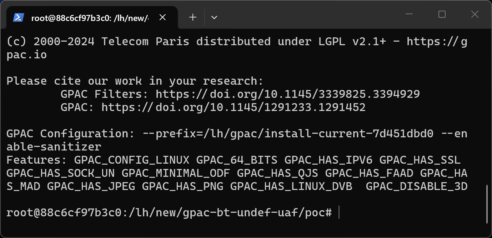
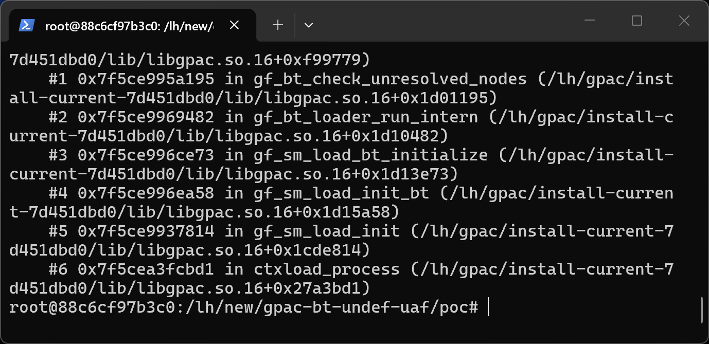
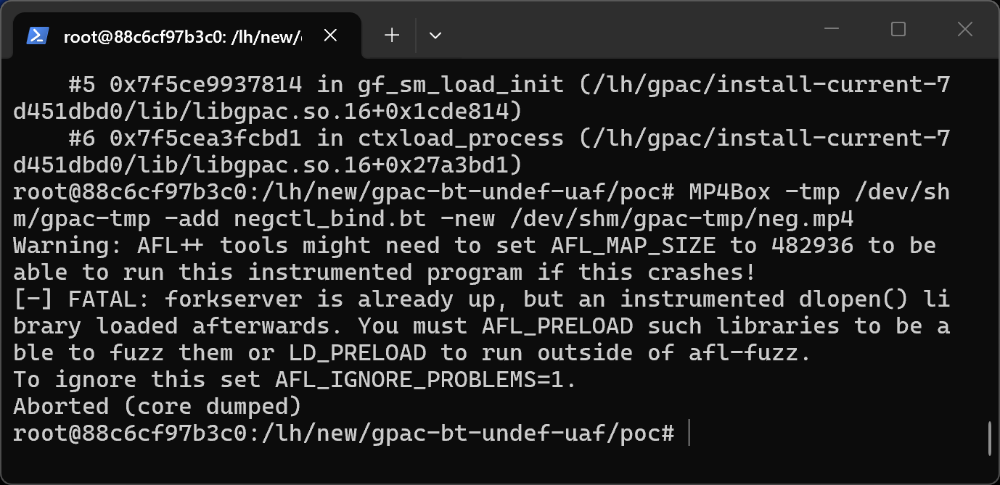

# GPAC 7d451dbd0 (master) — CWE-415 in gf_bt_check_unresolved_nodes

## Summary
GPAC (G Pac Media Framework) master commit 7d451dbd0 is affected by cwe-415 in gf_bt_check_unresolved_nodes. A crafted media file processed by MP4Box causes an out-of-bounds memory access with attacker-controlled content, leading to information disclosure and denial of service.

## Affected Product

| Field | Value |
|---|---|
| Vendor | GPAC |
| Product | GPAC / MP4Box |
| Affected versions | master commit 7d451dbd0 (libgpac ABI 16.27.0); earlier versions likely affected |
| Component | src/scene_manager/loader_bt.c:1238-1248 (gf_bt_check_unresolved_nodes) |
| Platform | Linux x86_64 (Ubuntu 22.04), ASan build; architecture-independent source defect |
| Vulnerability type | CWE-415: Double Free (via gf_node_unregister) with CWE-416 read |

## Root Cause
**Location:** `src/scene_manager/loader_bt.c:1238-1248 (gf_bt_check_unresolved_nodes)`

MP4Box crashes with an AddressSanitizer heap-use-after-free READ of 8 bytes while importing a crafted BT scene. gf_bt_check_unresolved_nodes (src/scene_manager/loader_bt.c:1238-1248) iterates parser->undef_nodes and, for each entry, calls gf_bt_report(..., gf_node_get_name(n)) followed by gf_node_unregister(n, NULL) without removing the entry from the list. When the same undefined node name is referenced twice, the parser stores the node twice in undef_nodes; the first iteration unregisters (frees) the node and the second iteration reads it in gf_node_get_name. The unconditional unregister with a NULL parent also bypasses normal parenting cleanup.

```c
for (i=0; i<count; i++) {
	GF_Node *n = (GF_Node *)gf_list_get(parser->undef_nodes, i);
	/* n may appear twice in undef_nodes: after the first gf_node_unregister
	   it is freed, and the next iteration reads it here */
	gf_bt_report(parser, GF_BAD_PARAM, "Cannot find node %s\n", gf_node_get_name(n) );
	gf_node_unregister(n, NULL);
}
```

## Proof of Concept

### Prerequisites
- MP4Box built from master (7d451dbd0); a plain release build exhibits the same memory error (verified under ASan).

### Steps to Reproduce
1. Extract the attached sample into a working directory.



2. Run the reproduction command:

```
MP4Box -tmp /tmp -add poc_bt_undef_uaf.bt -new /tmp/out.mp4
```

3. The process aborts with the sanitizer report below.



4. Negative control - the unmutated corpus file runs cleanly:

```
MP4Box -tmp /tmp -add negctl_bind.bt -new /tmp/negctl-out.mp4
```



### Expected vs Actual
- Expected: the parser rejects the malformed input with an error message.
- Actual: out-of-bounds memory access; under ASan the process aborts, in release builds the process crashes or silently reads adjacent heap memory.

### Sanitized PoC input
```text
poc_bt_undef_uaf.bt (binary/xml sample attached, SHA256 in SHA256SUMS.txt)
```

## Impact
- Confidentiality: High (use-after-free read of freed node memory)
- Integrity: High (double unregister corrupts heap and refcounts)
- Availability: High (process crash)
- Scope: memory corruption limited to the MP4Box process.

## Remediation
Remove each entry from undef_nodes (gf_list_del_item) before or after unregistering, and iterate over a stable copy of the list; the cleanup should also use the proper parent when unregistering.

## References
- Source repository: https://github.com/gpac/gpac
- Upstream report: [pending publication]
- CWE: CWE-415
- Vendor advisory: [none]
- Related upstream issues: https://github.com/gpac/gpac/issues/3642 and https://github.com/gpac/gpac/issues/3803 (this defect is an incomplete fix of that fix round: the undef_nodes list was not covered)
