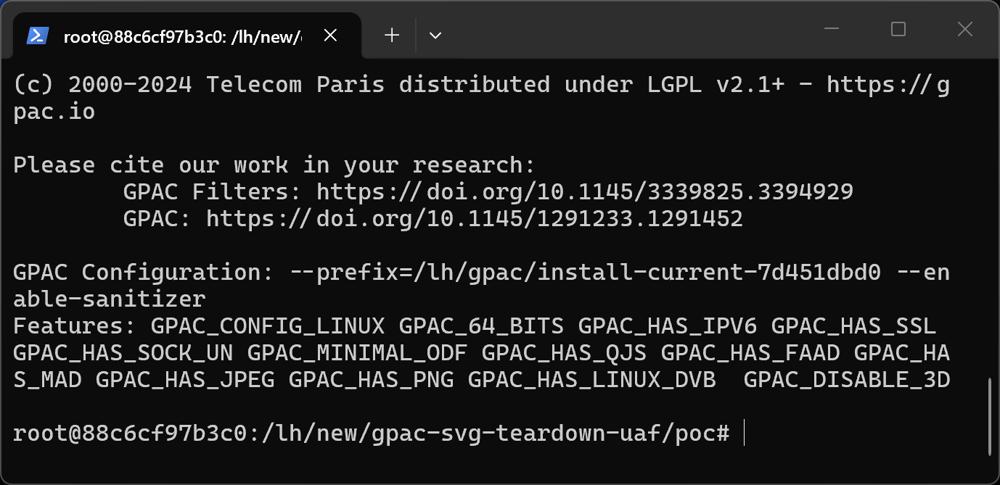
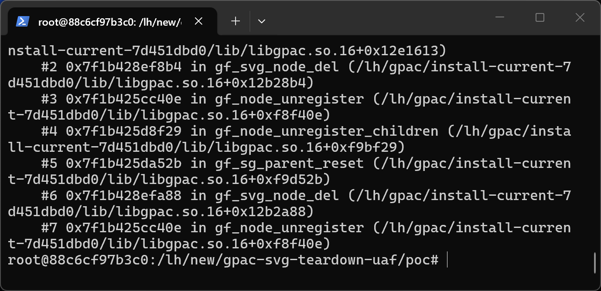
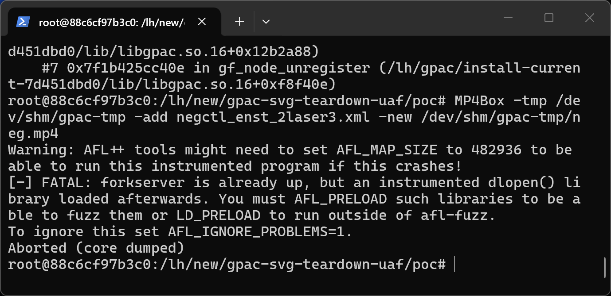

# GPAC 7d451dbd0 (master) — CWE-416 in gf_smil_anim_remove_from_target

## Summary
GPAC (G Pac Media Framework) master commit 7d451dbd0 is affected by cwe-416 in gf_smil_anim_remove_from_target. A crafted media file processed by MP4Box causes an out-of-bounds memory access with attacker-controlled content, leading to information disclosure and denial of service.

## Affected Product

| Field | Value |
|---|---|
| Vendor | GPAC |
| Product | GPAC / MP4Box |
| Affected versions | master commit 7d451dbd0 (libgpac ABI 16.27.0); earlier versions likely affected |
| Component | src/scenegraph/svg_types.c:117-121 (gf_svg_node_del) and src/scenegraph/smil_anim.c:1363-1367 (gf_smil_anim_remove_from_target) |
| Platform | Linux x86_64 (Ubuntu 22.04), ASan build; architecture-independent source defect |
| Vulnerability type | CWE-416: Use After Free |

## Root Cause
**Location:** `src/scenegraph/svg_types.c:117-121 (gf_svg_node_del) and src/scenegraph/smil_anim.c:1363-1367 (gf_smil_anim_remove_from_target)`

MP4Box crashes with an AddressSanitizer heap-use-after-free READ of 8 bytes while tearing down the scene graph after importing a crafted SVG/LASeR animation file. The SVG timed element keeps a resolved xlink-href target pointer (tap->xlinkp->href->target). When the scene is reset, nodes are unregistered recursively and the animation target node can be freed before the timed element that points to it; gf_svg_node_del (src/scenegraph/svg_types.c:117-121) then calls gf_smil_anim_remove_from_target() with the dangling target pointer, and gf_smil_anim_remove_from_target (src/scenegraph/smil_anim.c:1363-1367) immediately dereferences it in gf_node_animation_count(). No back-reference invalidation exists between href->target and the lifetime of the target node.

```c
if (gf_svg_is_timing_tag(node->sgprivate->tag)) {
	SVGTimedAnimBaseElement *tap = (SVGTimedAnimBaseElement *)node;
	if (tap->animp) {
		gf_free(tap->animp);
		/* href->target is a raw node pointer; the target may already be freed here */
		gf_smil_anim_remove_from_target((GF_Node *)tap, (GF_Node *)tap->xlinkp->href->target);
	}
```

## Proof of Concept

### Prerequisites
- MP4Box built from master (7d451dbd0); a plain release build exhibits the same memory error (verified under ASan).

### Steps to Reproduce
1. Extract the attached sample into a working directory.



2. Run the reproduction command:

```
MP4Box -tmp /tmp -add poc_svg_teardown_uaf.xml -new /tmp/out.mp4
```

3. The process aborts with the sanitizer report below.



4. Negative control - the unmutated corpus file runs cleanly:

```
MP4Box -tmp /tmp -add negctl_enst_2laser3.xml -new /tmp/negctl-out.mp4
```



### Expected vs Actual
- Expected: the parser rejects the malformed input with an error message.
- Actual: out-of-bounds memory access; under ASan the process aborts, in release builds the process crashes or silently reads adjacent heap memory.

### Sanitized PoC input
```text
poc_svg_teardown_uaf.xml (binary/xml sample attached, SHA256 in SHA256SUMS.txt)
```

## Impact
- Confidentiality: High (use-after-free read of freed node memory)
- Integrity: High (the freed node is also written back into during animation list cleanup in other paths)
- Availability: High (process crash)
- Scope: memory corruption limited to the MP4Box process.


## Remediation
Invalidate or lazily resolve href->target: either register the resolved target back-reference and clear it in gf_node_unregister/gf_node_del, or look the target up by name at deletion time instead of caching the raw pointer.


## References
- Source repository: https://github.com/gpac/gpac
- Upstream report: [pending publication]
- CWE: CWE-416
- Vendor advisory: [none]

